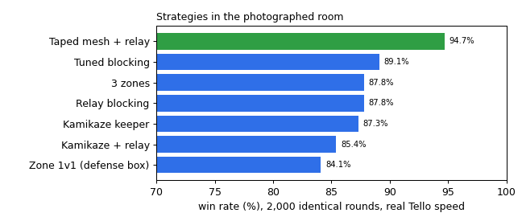
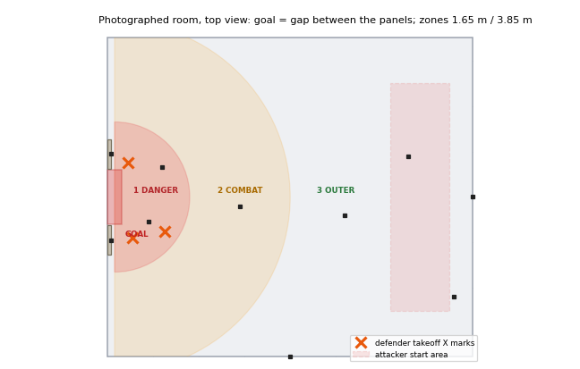

# Action Space: 3v2 counter-drone defense

Three DJI Tello EDU defenders keep two attacker Tellos (the same model) away from the goal in the
hackathon room. We built the game as a GPU simulator, designed six defense strategies, auto-tuned every
one of them on SF Compute H100s, and packaged the winner as a drop-in policy for the team's drone runner.



**Interactive 3D replay:** download [`media/replay/replay3d_arena_gate.html`](media/replay/replay3d_arena_gate.html)
and open it in a browser (self-contained, no install). Orbit the photographed room, pick any strategy,
scrub through the rounds, and read each drone's floating name tag (`D2 · goalkeeper`, `A1 · bumped back`).

## Contents

1. [The game](#the-game)
2. [The room](#the-room)
3. [Strategies, with simulations](#strategies-with-simulations)
4. [Results](#results)
5. [How the simulator works](#how-the-simulator-works)
6. [Auto-tuning on SF Compute](#auto-tuning-on-sf-compute)
7. [Fly it on the real drones](#fly-it-on-the-real-drones)
8. [Run it yourself](#run-it-yourself)
9. [Vision pipeline (RealSense, YOLO)](#vision-pipeline-realsense-yolo)
10. [What did not work](#what-did-not-work)
11. [Repo layout](#repo-layout)
12. [Known limits and next steps](#known-limits-and-next-steps)

## The game

- **Teams:** 3 defender Tellos (ours) against 2 attacker Tellos. Both teams fly the same model, so
  nobody is faster.
- **Scoring:** an attacker scores by reaching the goal. In the photographed room that is the gap
  between the two standing panels.
- **Contact:** touching an attacker only bumps it away; it drifts, recovers and comes back, often from a
  new angle. A hard, fast hit can knock both drones out of the air.
- **Losses:** a defender that hits a wall, a panel or a teammate goes down and stays down. The round goes
  on with the rest, so the defense has to recover: close gaps, re-assign, get back in front.
- **A round** lasts 30 s. The defense wins by holding out, or by taking both attackers down.

## The room



`config/arena_gate.json` is the room from the team's photos. The defense side has two standing white
panels (tags 9 and 6) with the goal gap between them, and three orange X marks where our Tellos take off.
The attack side has the big tag 10 on the far wall, and the attackers start there. The AprilTag ids were
read from the photos with the detector; positions are estimates from the photos. The coloured half-circles
are the three zones of the 3-zone strategy (danger 1.65 m, combat 3.85 m, as tuned).

## Strategies, with simulations

Each GIF is a real round from the simulator at real Tello speed, top view, the goal on the left. Blue
dots are our defenders, red dots the attackers, gray means down; the text next to each drone is what the
controller is doing at that moment. All strategies are switches of one controller,
`tello/controllers.py` (`BlockController`).

### 1. Tuned blocking (default): 89.1% wins


- Two **markers**, one per attacker. Each holds a point just in front of its attacker on the line from the
  attacker to the goal, aiming where the attacker will be 0.6 s later.
- When a marker is close and squarely in front, it **pushes** the attacker straight away from the goal at
  a fixed closing speed (never toward a wall, where our drone would hit it too).
- The third drone is the **goalkeeper**, on the line from the most dangerous attacker to the goal, just
  in front of the gap.
- **Recovery:** a marker that gets beaten loops around the attacker instead of chasing it from behind
  (chasing would push it toward the goal), and the defender already in front takes over its attacker.
- **Losses:** downed defenders drop out of the plan; outnumbered survivors all fall back to the goal.
- Safety: teammates keep 0.72 m apart (tuned), stay off walls and panels, and never fly into the goal zone.

### 2. Taped mesh + relay: 94.7% wins (best)


A strip of light mesh (the yellow bath-pouf netting) is taped under each defender, with tape on its lower
half. Carriers fly 0.35 m above the attacker's line so the attacker meets the mesh, not the drone, and
once close they drop the mesh onto it. An attacker that touches the tape sticks (85% in the model), the
mesh tears off and falls with it (yellow square), and our drone flies on without its mesh and goes back
to normal blocking. In the GIF both attackers are caught within seconds. **This number rests on the
85% stick assumption: test the tape on real drones first.**

### 3. Three zones: 87.8% wins


- **Zone 3, outer:** a marker whose attacker is still out there does not chase; it waits at the
  combat-zone edge on its attacker's line ("hold L2").
- **Zone 2, combat:** normal blocking and pushing.
- **Zone 1, danger:** an attacker that gets this close brings the reserve drone out to **reinforce**: two
  defenders push it until it is back in zone 2, then the reserve returns to goal.


Demo with a larger 2.5 m danger zone so the reinforcement is visible ("REINFORCE"). With the tuned 1.65 m
zone, attackers only got that close after two defenders were already down, when the rule keeps the last
one on goal instead.

### 4. Relay blocking: 87.8% wins


Man-to-man marking with a sweeper. Each marker predicts its attacker's path from its velocity and flies to
the first point on that path it can reach in time. A beaten marker hands its attacker to the defender in
front and retreats around the attacker to the defense point, becoming the new sweeper.

### 5. Kamikaze keeper: 87.3% wins


The defender nearest the goal is the keeper. It holds the line to the closest attacker inside a keeper
zone, and when that attacker comes within strike range (1.44 m, tuned) it rams it at full speed, aiming
where it is going ("KAMIKAZE"). A knocked-down attacker stays down: 3v2 becomes 2v1, a marker becomes the
new keeper, and it can strike the last attacker. At Tello speed (closing speed at most about 1.5 m/s) a
ram only knocks a drone down part of the time, so this is a last resort rather than a game changer.

### 6. Zone 1v1 (defense box): 84.1% wins

Every defender stays inside a box in front of the goal; each marker sits on its attacker's line at the
box edge until the attacker enters the box. It never gets drawn out by a bait, but attackers get a free
run up to the box. Inspired by another team's ground-station screenshot.

### Warhammer 40k labels


Same controller, themed labels (`tello/theme40k.py`): defenders are Guardsmen (G1-G3), attackers are
Heretics (H1, H2), the goalkeeper is the Castellan of the Shrine. Doctrines: Shield Wall (blocking),
Nets of Purity (mesh), Three Walls (zones), Rotating Ranks (relay), For the Emperor! (kamikaze).

## Results

**Photographed room, real Tello speed** (2,000 identical rounds per strategy, seed 7):

| Strategy | Win | Breach | Defenders lost / round | `DEFEND_STRATEGY=` |
|---|---|---|---|---|
| **Taped mesh + relay** | **94.7%** | 3.1% | 0.54 | `mesh` |
| Tuned blocking | 89.1% | 9.8% | 0.72 | `block` (default) |
| 3 zones | 87.8% | 10.7% | 0.69 | `layers` |
| Relay blocking | 87.8% | 11.1% | 0.73 | `relay` |
| Kamikaze keeper | 87.3% | 8.5% | 0.80 | `kamikaze` |
| Kamikaze + relay | 85.4% | 10.1% | 0.87 | - |
| Zone 1v1 (defense box) | 84.1% | 13.2% | 0.77 | - |

**How we got there** (earlier rooms and settings, for reference):

| Step | Win |
|---|---|
| First block controller, placeholder 8 x 6 m room, sim top speed 1.5 m/s | 60.7% |
| Same, after the first auto-tune | 74.9% |
| + loose mesh on all 3 defenders, mesh-aware flying | 87.3% (68.5% if the controller ignores the mesh) |
| + taped single-use mesh | 94.9% |
| Placeholder room at real Tello speed (0.73 m/s), re-tuned | 97.5% |
| Room built from the team's measured tag map (tag 10 as goal), best strategy (taped mesh) | 77.3% |

At real speed the defense does better than at 1.5 m/s because the attackers are just as slow. In the
measured-map room the walls I estimated from the tag positions squeeze the defense: with 1.5 m wider walls
the same settings went from 64% to 90%, so measuring the real flying area matters more than any tuning.

## How the simulator works

`source/action_space/.../defense_env.py` (`DefenseEnv`, an Isaac Lab DirectRLEnv), all in torch so
thousands of rounds run in parallel on one GPU:

- **Drones** are point masses with a first-order velocity lag, like a Tello following `send_rc_control`,
  at 20 Hz control. Real Tello speed comes from the team's motion fit: about 0.73 m/s at full stick.
- **Contacts:** equal-mass impulse bumps with restitution. A bump stuns the attacker for 0.5-1 s, then it
  attacks again, half the time via a new tactic. Hard hits knock drones down with a chance that grows
  with closing speed (0 below 0.7 m/s, certain above 1.4 m/s, our drone too in half the cases).
- **Mesh:** a strip below each carrier that trails behind its motion; an attacker entering it is caught
  with a set chance; the taped version tears off and drops with the attacker.
- **Obstacles:** the two panels are solid; defenders that touch one go down, attackers slide off.
- **Attackers** pick a tactic every round: direct, flank along a side wall, feint, high/low, or bait
  (hover mid-room, then go). Speed, dodging skill and weaving are random per round.
- **Domain randomization:** defender lag and top speed, wind drift, sensor noise (5 cm defenders, 10 cm
  attackers), 0-100 ms latency, and a 30% chance that one defender fails mid-round.

`scripts/fast_sim.py` runs the same game files without Isaac Sim (it stands in for the few Isaac
classes they touch), gives identical numbers on the same seed, starts in a second, and runs on any GPU.

## Auto-tuning on SF Compute

Each strategy has 14-17 settings (gains, gaps, lead time, push radius and speed, spacing, wall buffer,
strike distances, zone sizes). `fast_sim.py tune` uses the cross-entropy method: every generation (on the
cloud runs) 24 candidate settings each fly 256 parallel arenas of the randomized game, the best 6 are kept, and the
next generation is sampled around them; after 15-20 generations the best are re-checked on 3,000 fresh
rounds and saved only if they beat the start.

We ran 28 tunes on up to 4 SF Compute H100 nodes at once (Autoresearch CLI `autor`, from WSL), plus
the laptop, then re-checked every winner on the same 2,000 rounds for the tables above. The tuned files
are in `config/` (`gate_*.json` and `block_tuned_gate_mesh_real.json` for the photographed room).

## Fly it on the real drones

`integration/swarm_ops/` is a drop-in for the team repo's runner (`drone_deployment_infra/swarm_ops/policies/`
in jaromero3rd/Action_Space). It replaces the `spin` defensive dummy:

1. Copy `defend.py`, `defense_core/` and the patched `__init__.py` into `swarm_ops/policies/`.
2. In drone_gui, set the defenders' team to `defense`, the attackers to `attack`, and add the telemetry
   destination `127.0.0.1:9101`.
3. `DEFEND_STRATEGY=block python swarm_policies.py --run defend:5,6,7 --fly`

Every tick the policy reads the fleet telemetry (UDP JSON v1: each drone's team and its AprilTag pose),
converts every pose into the room frame, runs the controller on the whole snapshot, and returns each
defender's `(left_right, forward_back, up_down, yaw)` with the team's motion fit. All defenders see the
same snapshot and the controller is deterministic, so they agree on who marks whom without talking.
Without fresh telemetry a defender holds its height. Details in
[`integration/swarm_ops/README.md`](integration/swarm_ops/README.md).

Other tools in `tello/`:

- `defense_policy.py`: the same policy as a stand-alone telemetry listener (`--selftest` plays a game
  without hardware).
- `ground_station.py`: our own flight loop (RealSense + AprilTag localization + djitellopy), with a
  `--sim` mode, speed test, safety keys (land all, emergency stop) and mesh / relay / zone / kamikaze switches.
- `station_mode.py`: put Tello EDUs on one router (`join`, `scan --write`, `check`).
- `localizer.py`, `realsense_tracker.py`: AprilTag pose from a Tello camera (also the downward camera),
  and depth-camera attacker tracking (background subtraction, Kalman filter, Hungarian assignment).

## Run it yourself

No Isaac needed (Python with torch, numpy, opencv):

```
python scripts/fast_sim.py eval   --arena arena_gate --real_speed --tuned config/gate_block.json
python scripts/fast_sim.py eval   --arena arena_gate --real_speed --task sticky --tuned config/block_tuned_gate_mesh_real.json --ctrl '{"relay": true, "net_carriers": [true, true, true]}'
python scripts/fast_sim.py tune   --arena arena_gate --real_speed --out config/my_settings.json
python scripts/fast_sim.py record --arena arena_gate --real_speed --tuned config/gate_layers.json --name my_clip --theme 40k
ARENA_JSON=arena_gate python scripts/build_replay.py          # 2D + 3D replay pages in media/replay/
python scripts/make_readme_media.py                            # the GIFs and charts in docs/img/
```

With Isaac Lab 2.3 / Isaac Sim 5.1: `scripts/play_arena.py` (live 3D viewer with Tello models),
`scripts/eval_controllers.py` and `scripts/tune_block.py` (same as fast_sim, inside Isaac),
`scripts/vision_loop.py` (vision in the loop), `scripts/rsl_rl/train.py` (PPO).

## Vision pipeline (RealSense, YOLO)

`scripts/vision_loop.py` renders a RealSense twin (848 x 480 RGB-D) in Isaac Sim, and the real
ground-station code runs on it: depth background subtraction finds blobs, blobs next to a defender (or
along its mesh strip) correct that defender, the rest feed a Kalman + Hungarian attacker tracker, and the
tracks drive the controller. It tracked attackers with about 6 cm error, 74-91% of the time
(`media/videos/vision_depth_relay.mp4`). The same run exports auto-labeled frames for YOLOv8
(`scripts/train_yolo.py`). For the competition the judges provide every drone's position, so the flight
policy does not need this pipeline.

## What did not work

- **PPO.** From scratch: 0% wins after 300 iterations. Residual PPO on top of the block controller started
  at 58% and drifted down to 34%. The scripted controller plus auto-tuning won clearly.
- **YOLOv8** trained without errors on the synthetic frames, but its confidence never rises above 0.001,
  so it detects nothing (`media/videos/vision_yolo_*`). Not debugged; the depth pipeline works.
- **Kamikaze at Tello speed** rarely knocks a drone down, and the keeper leaves the gap open.

## Repo layout

```
config/        rooms (arena_*.json), tuned settings, Tello camera calibrations, drone list (tellos.json)
integration/   drop-in defense policy for the team's swarm_ops runner
scripts/       fast_sim (no-Isaac game, tune, record), replays, README media, Isaac viewers, vision, YOLO
source/        Isaac Lab tasks: DefenseEnv (the 3v2 game) and the earlier intercept/swarm envs
tello/         controller, telemetry policy, ground station, station mode, localization, tracking, 40k labels
media/         3D replay, vision videos, AprilTag images
docs/          SF Compute guides, README images
```

## Known limits and next steps

- Measure the room: the panels, the X marks, the tag positions and the walls of the flying area, then
  update `config/arena_gate.json` and re-tune (about 15 minutes on one H100).
- Knockdown and mesh catch probabilities are assumptions; a few bump tests on real drones would pin them down.
- Defenders clip a panel about once every 3 rounds in the sim, in every strategy; worth a look at the
  takeoff positions and panel margins.
- The team's measured tag map and the photos disagree on the panel tags; one more mapping pass would settle it.

## SF Compute guides

[`docs/sf_compute_cli_setup.md`](docs/sf_compute_cli_setup.md) (sf CLI and Isaac Lab on a VM, by Juan)
and [`docs/sfcompute_training.md`](docs/sfcompute_training.md) (training runs). `scripts/01_scene.py` is
the original Isaac Lab site-defense scene scaffold.
